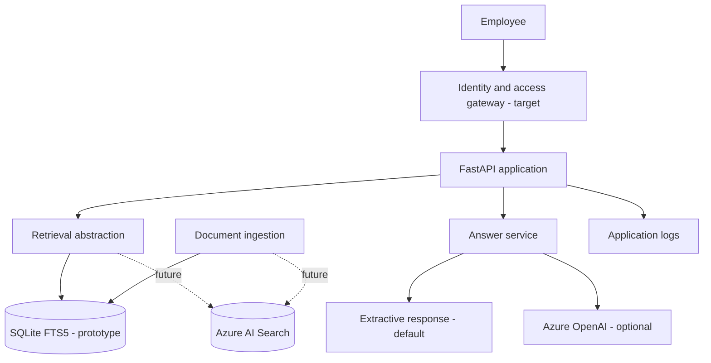

# Logical architecture

Solid paths exist in the local prototype. Dashed paths are future integration work. Azure OpenAI calls are optional and require separately provisioned resources.

## Trust boundaries

- Browser to API: **untrusted** until identity and request validation are in place.
- Document index to answer generator: **untrusted content**; never execute document instructions.
- Application to Azure OpenAI: external managed-service boundary; configure approved deployment, network access and data handling.
- Ingestion pipeline to index: controlled publishing boundary; document ownership and classification must be verified.

The prototype is not suitable for an internet-facing deployment with sensitive documents.
