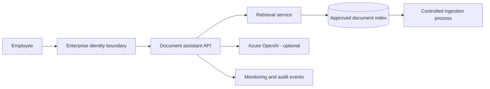

# Secure Enterprise GenAI / RAG Reference Architecture

A reference design and runnable prototype for an internal document assistant on Microsoft Azure.

The problem is familiar: teams have policies, procedures and technical documents spread across shared drives, but finding a reliable answer takes longer than it should. This project explores a practical way to retrieve relevant passages, send only those passages to a language model, and show users where the answer came from.

This is **Project 2** in a wider architecture portfolio. It builds on the [Enterprise AI Governance Framework](https://github.com/Shulin-Shiriskar/enterprise-ai-governance-framework) by turning governance requirements into technical decisions and testable controls.

> **Scope and honesty:** The repository includes a working local prototype and an Azure deployment starting point. It is **not** a production-approved solution. The local retrieval engine is SQLite FTS5 rather than Azure AI Search; authentication, document-level authorisation, private networking, centralised audit logging and production operations need to be completed before real organisational data is used.

## What is included

| Area | Contents |
|---|---|
| [01 — Architecture](01-architecture/) | Solution context, logical design, decision records and deployment choices |
| [02 — Security](02-security/) | Threat model, trust boundaries, control checklist and production gaps |
| [03 — RAG Design](03-rag-design/) | Ingestion, retrieval, grounding, evaluation and limitations |
| [04 — Governance](04-governance/) | Risk assessment and governance gates linked to Project 1 |
| [05 — Operations](05-operations/) | Monitoring, incident response, costs and release readiness |
| [06 — Implementation](06-implementation/) | FastAPI app, local search, tests, container image and Terraform starter |

## Architecture at a glance



The diagram is the **target pattern**, not a claim that every control is implemented in the prototype. See [the implementation gap register](02-security/production-gap-register.md).

## Run the prototype locally

Python 3.11+ is recommended.

```bash
cd 06-implementation
python -m venv .venv
source .venv/bin/activate
pip install -r requirements.txt
python scripts/ingest.py
uvicorn app.main:app --reload
```

On Windows, activate the virtual environment with `.venv\Scripts\activate`.

Open `http://127.0.0.1:8000/docs` and use `POST /ask` with:

```json
{"question": "Who approves a high-risk AI use case?"}
```

By default, the app runs in **extractive mode**: it returns the most relevant passage and its source, without generating new text. This makes it usable without Azure credentials. Set `ANSWER_MODE=azure` and the Azure OpenAI settings in [the environment example](06-implementation/.env.example) to enable model-generated answers. No credentials are required for local extractive mode.

The sample documents are fictional and deliberately non-sensitive. **Do not ingest private or confidential documents into this demo.**

## Test it

```bash
cd 06-implementation
pip install -r requirements-dev.txt
python -m pytest -q
```

## Azure deployment

The [Terraform starter](06-implementation/infra/) provisions a basic Container Apps hosting environment and observability workspace. It does **not** provision a secured enterprise RAG stack or an Azure OpenAI model deployment. An existing Azure subscription, container image and separately managed AI service are required. Follow [deployment instructions](06-implementation/DEPLOYMENT.md) and review the [production gaps](02-security/production-gap-register.md) first.

## Design choices

- Retrieval is separated from answer generation so each can be tested independently.
- Source passages are returned with every response.
- The assistant is instructed to stay within the retrieved context and admit when evidence is missing.
- Prompt injection in retrieved documents is treated as untrusted input, not as an instruction.
- No personal or operational data is included in the sample corpus.
- Security controls that are only proposed are explicitly marked as such.

## Status

**v0.1 — Working prototype and architecture baseline.** Next steps are identity integration, document-level access enforcement, Azure AI Search, private networking and an evaluation suite with measurable acceptance thresholds.

## Disclaimer

Independent portfolio project using a fictional transport organisation. Not affiliated with Microsoft or any transport operator. Framework references indicate design alignment, not certification or regulatory compliance.

## Licence

MIT. See [LICENSE](LICENSE).
